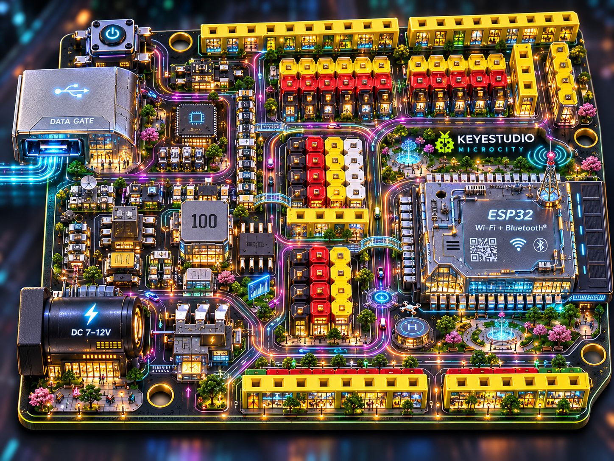

====================================================
Capítulo 1: El Mapa del Tesoro - Tu Placa ESP32
====================================================

¡Bienvenidos, ingenieros e ingenieras!

Hoy vamos a conocer al protagonista de todas nuestras aventuras tecnológicas: la placa de desarrollo **STEAMakers**. Esta placa tiene un superpoder oculto: lleva dentro un chip llamado **ESP32**. 

Si la miras de cerca, verás que parece una pequeña ciudad llena de carreteras brillantes y mini-componentes. ¡Vamos a descubrir qué es cada cosa!

El Cerebro: El Chip ESP32
=========================

.. image:: /_static/capitulo1/placa_steamakers.png
   :alt: Detalle de la placa
   :align: center
   :width: 400px
   
El cuadrado metálico que ves en el **centro-derecha** es el **ESP32**, el auténtico cerebro de la placa. Es el encargado de pensar, hacer matemáticas súper rápido y obedecer las órdenes que tú le escribas desde la computadora.

.. note::
   **¡Un Cerebro con Superpoderes!** 🧠
   A diferencia de las placas más antiguas, el ESP32 viene con **Wi-Fi y Bluetooth** integrados de fábrica. ¡Eso significa que tu placa puede conectarse a internet, hablar con tu teléfono móvil o recibir órdenes desde el otro lado de la habitación!

Los Músculos: Los Pines de Conexión (GPIO)
===========================================

¿Ves esas filas de agujeros amarillos en los bordes? Se llaman **Pines GPIO** (Pines de Entrada y Salida de Propósito General). 

Son los "músculos" y los "sentidos" de nuestra placa. Gracias a ellos podemos conectar cables para:

* **Dar órdenes (Salidas):** Encender luces LED, hacer sonar un zumbador o mover las ruedas de un robot.
* **Escuchar al mundo (Entradas):** Saber si un botón está pulsado o medir la luz de la habitación con un sensor.

.. warning::
   **¡Cuidado con la electricidad!** ⚡
   La placa funciona con un voltaje muy bajo y seguro para ti (3.3 Voltios o 5 Voltios). Pero recuerda: **¡nunca conectes cables a lo loco!** Si juntas la patita de energía (VCC) con la de tierra (GND) directamente sin pasar por un componente, causarás un **cortocircuito**. ¡Sigue siempre los esquemas como un auténtico profesional!

Los Sentidos Integrados de STEAMakers
=====================================

Una de las cosas más divertidas de la placa de STEAMakers es que **ya viene con "juguetes" soldados de fábrica**. No necesitas cables para empezar a jugar con estos tres componentes integrados:

1. **El LED RGB:** Una pequeña bombilla que puede brillar en millones de colores diferentes (Rojo, Verde, Azul y sus mezclas).
2. **El Pulsador:** Un botón mini para que la placa sepa cuándo lo estás presionando.
3. **El Zumbador (Buzzer):** Un mini-altavoz que puede pitar para avisarte de algo o incluso tocar melodías de tus videojuegos favoritos.

¿Cómo le damos energía?
=======================

Para que el cerebro despierte, necesita "comida". Tienes dos formas de darle energía:

* El conector **USB**: Sirve para conectarlo a tu Mac. No solo le da electricidad, ¡también es el túnel por el que le enviaremos nuestros códigos de programación!
* El conector de **Batería**: Para cuando tu proyecto esté terminado (por ejemplo, un coche robot) y quieras que funcione libremente por el suelo sin cables.

¡Tu turno de inspección!
=========================

.. todo::
   Coge tu placa de STEAMakers con cuidado por los bordes. Busca el chip cuadrado del ESP32 y localiza el pequeño botón integrado. ¿Eres capaz de encontrar dónde está escondida la antena de Wi-Fi? (Pista: suele ser una línea blanca o una zona con una pista de cobre en forma de zigzag).
